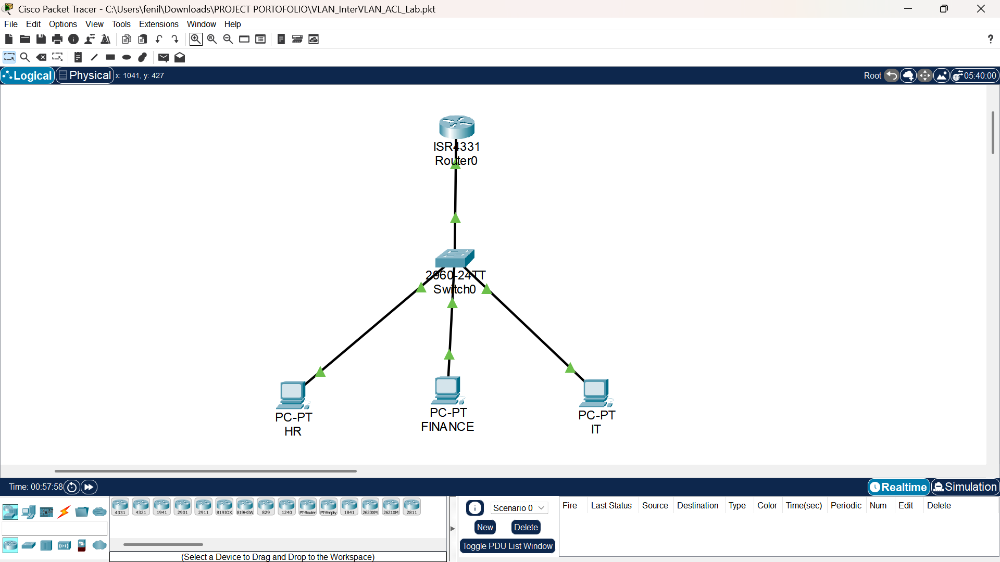

# Secure Multi-VLAN Office Network

Simulasi jaringan kantor menggunakan **Cisco Packet Tracer** dengan implementasi VLAN, 802.1Q trunking, Router-on-a-Stick, inter-VLAN routing, dan Extended Access Control List (ACL) untuk mengatur komunikasi antar-departemen.

## Deskripsi Project

Project ini merupakan simulasi jaringan kantor sederhana yang membagi jaringan menjadi tiga departemen, yaitu Human Resources (HR), Finance, dan Information Technology (IT).

Setiap departemen ditempatkan pada VLAN dan subnet yang berbeda untuk menerapkan segmentasi jaringan. Komunikasi antar-VLAN dilakukan menggunakan metode **Router-on-a-Stick**, sedangkan Extended ACL digunakan untuk membatasi komunikasi berdasarkan kebijakan keamanan yang telah ditentukan.

Project ini dibuat sebagai bagian dari portofolio untuk menunjukkan pemahaman dasar mengenai konfigurasi jaringan Cisco, segmentasi jaringan, pengendalian akses, verifikasi konektivitas, dan troubleshooting.

## Tujuan Project

Project ini bertujuan untuk mempraktikkan:

1. Segmentasi jaringan menggunakan VLAN.
2. Konfigurasi access port pada switch.
3. Konfigurasi trunking menggunakan IEEE 802.1Q.
4. Implementasi Router-on-a-Stick.
5. Konfigurasi inter-VLAN routing.
6. Konfigurasi IPv4 address dan default gateway.
7. Implementasi Extended Access Control List (ACL).
8. Pembatasan komunikasi antar-departemen.
9. Pengujian konektivitas menggunakan ICMP/Ping.
10. Verifikasi konfigurasi menggunakan perintah Cisco IOS.
11. Troubleshooting konektivitas dan validasi aturan ACL.

## Teknologi yang Digunakan

- Cisco Packet Tracer
- Cisco IOS
- IPv4 Addressing
- VLAN
- IEEE 802.1Q Trunking
- Router-on-a-Stick
- Inter-VLAN Routing
- Extended Access Control List (ACL)
- ICMP/Ping
- Cisco IOS Verification Commands

## Topologi Jaringan



Topologi jaringan terdiri dari:

- 1 Cisco ISR 4331 Router
- 1 Cisco Catalyst 2960-24TT Switch
- 3 PC yang mewakili departemen HR, Finance, dan IT

Router terhubung ke switch menggunakan satu link trunk 802.1Q. Link tersebut membawa trafik dari VLAN 10, VLAN 20, dan VLAN 30 menuju router untuk proses routing dan penerapan ACL.

### Gambaran Topologi

```text
                    +---------------------+
                    |    Cisco ISR 4331   |
                    |  Router-on-a-Stick  |
                    +----------+----------+
                               |
                         802.1Q Trunk
                               |
                    +----------+----------+
                    | Cisco Catalyst 2960 |
                    +-----+---------+-----+
                          |         |
                    +-----+--+  +---+-----+
                    |        |  |         |
                  VLAN 10  VLAN 20     VLAN 30
                    |        |           |
                   HR     Finance        IT
                192.168.10.10 192.168.20.10 192.168.30.10
```

## VLAN dan IP Addressing

| Departemen | VLAN ID | Network | Default Gateway | IP Address PC |
|---|---:|---|---|---|
| HR | 10 | 192.168.10.0/24 | 192.168.10.1 | 192.168.10.10 |
| Finance | 20 | 192.168.20.0/24 | 192.168.20.1 | 192.168.20.10 |
| IT | 30 | 192.168.30.0/24 | 192.168.30.1 | 192.168.30.10 |

Seluruh PC menggunakan subnet mask `255.255.255.0`.

Setiap VLAN menggunakan subnet yang berbeda sehingga masing-masing departemen berada dalam broadcast domain yang terpisah.

## Konfigurasi Switch

### Pembagian Port

| Port Switch | Mode | VLAN | Departemen |
|---|---|---:|---|
| Fa0/1 | Access | 10 | HR |
| Fa0/2 | Access | 20 | Finance |
| Fa0/3 | Access | 30 | IT |
| Gi0/1 | Trunk | 10, 20, 30 | Router |

### Konfigurasi VLAN

Contoh konfigurasi VLAN pada switch:

```cisco
enable
configure terminal

vlan 10
 name HR
exit

vlan 20
 name FINANCE
exit

vlan 30
 name IT
exit
```

### Konfigurasi Access Port

```cisco
interface FastEthernet0/1
 switchport mode access
 switchport access vlan 10
exit

interface FastEthernet0/2
 switchport mode access
 switchport access vlan 20
exit

interface FastEthernet0/3
 switchport mode access
 switchport access vlan 30
exit
```

### Konfigurasi Trunk

```cisco
interface GigabitEthernet0/1
 switchport mode trunk
exit
```

Port `GigabitEthernet0/1` digunakan untuk menghubungkan switch dengan router dan membawa trafik dari VLAN yang diperlukan.

Konfigurasi diverifikasi menggunakan:

```cisco
show vlan brief
show interfaces trunk
```

Hasil verifikasi menunjukkan bahwa VLAN 10, VLAN 20, dan VLAN 30 telah dibuat serta port trunk berada dalam status `trunking`.

## Konfigurasi Router-on-a-Stick

Router menggunakan satu physical interface, yaitu `GigabitEthernet0/0/0`, dengan beberapa subinterface untuk menangani trafik dari VLAN yang berbeda.

### Pembagian Subinterface

| Subinterface | VLAN ID | IP Address | Fungsi |
|---|---:|---|---|
| G0/0/0.10 | 10 | 192.168.10.1/24 | Gateway HR |
| G0/0/0.20 | 20 | 192.168.20.1/24 | Gateway Finance |
| G0/0/0.30 | 30 | 192.168.30.1/24 | Gateway IT |

### Konfigurasi Subinterface

```cisco
interface GigabitEthernet0/0/0
 no ip address
 no shutdown
exit

interface GigabitEthernet0/0/0.10
 encapsulation dot1Q 10
 ip address 192.168.10.1 255.255.255.0
 ip access-group BLOCK-HR-FINANCE in
exit

interface GigabitEthernet0/0/0.20
 encapsulation dot1Q 20
 ip address 192.168.20.1 255.255.255.0
 ip access-group BLOCK-FINANCE in
exit

interface GigabitEthernet0/0/0.30
 encapsulation dot1Q 30
 ip address 192.168.30.1 255.255.255.0
exit
```

Perintah `encapsulation dot1Q` menghubungkan setiap subinterface dengan VLAN ID yang sesuai. IP address pada masing-masing subinterface digunakan sebagai default gateway bagi PC di VLAN tersebut.

## Kebijakan Keamanan Jaringan

Extended ACL digunakan untuk mengendalikan komunikasi antar-departemen berdasarkan alamat IP sumber dan tujuan.

### Matriks Kebijakan Akses

| Sumber | Tujuan | Kebijakan |
|---|---|---|
| HR | Finance | Diblokir |
| HR | IT | Diizinkan |
| Finance | HR | Diblokir |
| Finance | IT | Diblokir |
| Finance | Gateway sendiri | ICMP diizinkan |

Kebijakan tersebut diterapkan menggunakan ACL inbound pada subinterface router:

- `G0/0/0.10` menggunakan ACL `BLOCK-HR-FINANCE`.
- `G0/0/0.20` menggunakan ACL `BLOCK-FINANCE`.

**Catatan:** ACL Finance tidak memiliki aturan `permit ip` umum. Oleh karena itu, trafik yang tidak cocok dengan aturan yang diizinkan akan terkena *implicit deny*. Kebijakan ini membatasi akses Finance lebih luas daripada hanya memblokir HR dan IT.

## Konfigurasi Extended ACL

### 1. ACL untuk Departemen HR

ACL `BLOCK-HR-FINANCE` digunakan untuk memblokir trafik dari HR menuju Finance dan mengizinkan trafik dari HR menuju IT.

```cisco
ip access-list extended BLOCK-HR-FINANCE
 deny ip 192.168.10.0 0.0.0.255 192.168.20.0 0.0.0.255
 permit ip 192.168.10.0 0.0.0.255 192.168.30.0 0.0.0.255
```

ACL diterapkan secara inbound pada subinterface HR:

```cisco
interface GigabitEthernet0/0/0.10
 ip access-group BLOCK-HR-FINANCE in
```

Penjelasan aturan:

1. `deny ip` memblokir trafik dari subnet HR menuju subnet Finance.
2. `permit ip` mengizinkan trafik dari subnet HR menuju subnet IT.
3. Trafik lain yang tidak cocok dengan aturan `permit` akan terkena *implicit deny*.

### 2. ACL untuk Departemen Finance

ACL `BLOCK-FINANCE` digunakan untuk memblokir komunikasi dari Finance menuju HR dan IT, serta mengizinkan ICMP dari Finance menuju gateway-nya sendiri.

```cisco
ip access-list extended BLOCK-FINANCE
 deny ip 192.168.20.0 0.0.0.255 192.168.10.0 0.0.0.255
 permit icmp 192.168.20.0 0.0.0.255 host 192.168.20.1
 deny ip 192.168.20.0 0.0.0.255 192.168.30.0 0.0.0.255
```

ACL diterapkan secara inbound pada subinterface Finance:

```cisco
interface GigabitEthernet0/0/0.20
 ip access-group BLOCK-FINANCE in
```

Penjelasan aturan:

1. `deny ip` memblokir trafik dari Finance menuju subnet HR.
2. `permit icmp` mengizinkan paket ICMP dari Finance menuju alamat gateway `192.168.20.1`.
3. `deny ip` memblokir trafik dari Finance menuju subnet IT.
4. Trafik lain yang tidak cocok dengan aturan `permit` akan terkena *implicit deny*.

ACL diproses secara berurutan, sehingga urutan aturan harus diperhatikan saat merancang kebijakan akses.

## Pengujian Konektivitas

Pengujian dilakukan menggunakan perintah `ping` dari masing-masing PC untuk memverifikasi konektivitas serta perilaku ACL.

### 1. HR menuju Finance

Perintah pada PC HR:

```text
ping 192.168.20.10
```

Hasil pengujian:

```text
Reply from 192.168.10.1: Destination host unreachable.

Packets: Sent = 4, Received = 0, Lost = 4 (100% loss)
```

**Hasil:** Ping gagal sesuai dengan kebijakan yang dirancang untuk memblokir komunikasi HR menuju Finance.

### 2. HR menuju IT

Perintah pada PC HR:

```text
ping 192.168.30.10
```

Hasil pengujian:

```text
Packets: Sent = 4, Received = 4, Lost = 0 (0% loss)
```

**Hasil:** Berhasil. PC HR dapat berkomunikasi dengan PC IT.

### 3. Finance menuju HR

Perintah pada PC Finance:

```text
ping 192.168.10.10
```

Hasil pengujian:

```text
Reply from 192.168.20.1: Destination host unreachable.

Packets: Sent = 4, Received = 0, Lost = 4 (100% loss)
```

**Hasil:** Ping gagal sesuai dengan kebijakan pembatasan komunikasi Finance menuju HR.

### 4. Finance menuju IT

Perintah pada PC Finance:

```text
ping 192.168.30.10
```

Hasil pengujian:

```text
Reply from 192.168.20.1: Destination host unreachable.

Packets: Sent = 4, Received = 0, Lost = 4 (100% loss)
```

**Hasil:** Ping gagal sesuai dengan kebijakan pembatasan komunikasi Finance menuju IT.

### 5. Finance menuju Gateway

Perintah pada PC Finance:

```text
ping 192.168.20.1
```

Hasil pengujian:

```text
Packets: Sent = 4, Received = 4, Lost = 0 (0% loss)
```

**Hasil:** Berhasil. PC Finance dapat melakukan ping ke gateway-nya sendiri.

### Ringkasan Pengujian

| Pengujian | Hasil yang Diharapkan | Hasil Aktual |
|---|---|---|
| HR → Finance | Diblokir | Sesuai |
| HR → IT | Diizinkan | Sesuai |
| Finance → HR | Diblokir | Sesuai |
| Finance → IT | Diblokir | Sesuai |
| Finance → Gateway | Diizinkan | Sesuai |

Pesan ping yang gagal tidak selalu membuktikan bahwa ACL merupakan penyebabnya. Oleh karena itu, hasil pengujian juga dibandingkan dengan konfigurasi router dan penghitung ACL.

## Verifikasi Konfigurasi

Beberapa perintah Cisco IOS digunakan untuk memverifikasi konfigurasi jaringan.

### Verifikasi VLAN

```cisco
show vlan brief
```

Perintah ini digunakan untuk memeriksa VLAN yang tersedia serta assignment port access.

Hasil yang diharapkan:

- VLAN 10 berada pada Fa0/1.
- VLAN 20 berada pada Fa0/2.
- VLAN 30 berada pada Fa0/3.

### Verifikasi Trunk

```cisco
show interfaces trunk
```

Perintah ini digunakan untuk memeriksa status trunk, encapsulation, dan VLAN yang aktif pada link trunk.

Hasil pengujian menunjukkan port `GigabitEthernet0/1` menggunakan 802.1Q dan berada dalam status `trunking`.

### Verifikasi Interface Router

```cisco
show ip interface brief
```

Perintah ini digunakan untuk memeriksa status interface serta IP address pada router.

Subinterface yang diverifikasi:

```text
GigabitEthernet0/0/0.10    192.168.10.1    up    up
GigabitEthernet0/0/0.20    192.168.20.1    up    up
GigabitEthernet0/0/0.30    192.168.30.1    up    up
```

### Verifikasi Routing

```cisco
show ip route
```

Perintah ini digunakan untuk memeriksa tabel routing dan memastikan jaringan VLAN terhubung secara langsung melalui subinterface router.

### Verifikasi ACL

```cisco
show access-lists
```

Perintah ini digunakan untuk memeriksa aturan ACL dan jumlah paket yang cocok dengan masing-masing aturan (*match counters*).

Penghitung ACL membantu memverifikasi bahwa trafik pengujian cocok dengan aturan yang telah dikonfigurasi.

### Verifikasi Konfigurasi Lengkap

```cisco
show running-config
```

Perintah ini digunakan untuk memeriksa konfigurasi aktif router, termasuk IP address, subinterface, serta penerapan ACL.

## Troubleshooting

Selama proses implementasi, dilakukan troubleshooting untuk mengisolasi masalah konektivitas pada jaringan Finance.

### Kasus: PC Finance Tidak Dapat Melakukan Ping ke Gateway

Pada tahap awal pengujian, PC Finance mengalami kegagalan ping menuju gateway saat ACL Finance diterapkan.

Langkah troubleshooting yang dilakukan:

1. Memeriksa konfigurasi IP address, subnet mask, dan default gateway pada PC Finance.
2. Memeriksa status subinterface router.
3. Memverifikasi konfigurasi VLAN dan trunk pada switch.
4. Memeriksa tabel MAC address dan ARP untuk memastikan perangkat terdeteksi.
5. Melepas sementara ACL Finance untuk mengisolasi perilaku konektivitas.
6. Menguji kembali ping menuju gateway.
7. Menambahkan aturan izin ICMP menuju gateway Finance.
8. Memasang kembali ACL pada subinterface Finance.
9. Menguji kembali ping gateway dan komunikasi menuju VLAN lain.
10. Memeriksa penghitung ACL menggunakan `show access-lists`.

**Hasil:** Setelah aturan ICMP ditambahkan dan ACL dipasang kembali, ping menuju gateway Finance berhasil. Pengujian menuju HR dan IT tetap gagal sesuai kebijakan, serta penghitung ACL diperiksa untuk memvalidasi aturan yang cocok.

Proses ini memberikan pengalaman dalam mengisolasi masalah, memeriksa konfigurasi, dan memvalidasi hasil perubahan pada Cisco Packet Tracer.

## Ringkasan Keterampilan

Melalui project ini, saya mempraktikkan:

- Konfigurasi VLAN dan segmentasi jaringan.
- Konfigurasi access port dan trunk port.
- IPv4 addressing dan subnetting dasar.
- Konfigurasi default gateway.
- Implementasi Router-on-a-Stick.
- Inter-VLAN routing.
- Implementasi Extended ACL.
- Pengendalian trafik antar-subnet.
- Pengujian konektivitas menggunakan ICMP/Ping.
- Verifikasi konfigurasi menggunakan Cisco IOS.
- Analisis ACL match counters.
- Troubleshooting konektivitas jaringan.

## Struktur File Project

```text
secure-multi-vlan-office-network/
├── README.md
├── VLAN_InterVLAN_ACL_Lab.pkt
└── network-topology.png
```

Keterangan:

- `README.md` berisi dokumentasi topologi, konfigurasi, kebijakan keamanan, dan hasil pengujian.
- `VLAN_InterVLAN_ACL_Lab.pkt` berisi simulasi jaringan yang dapat dibuka menggunakan Cisco Packet Tracer.
- `network-topology.png` berisi gambar topologi jaringan.

Pastikan nama file dan lokasi file sesuai dengan yang tersedia di repositori GitHub.

## Status Project

**Status: Completed — Lab Tested**

Project ini telah mencakup implementasi dan pengujian:

- VLAN segmentation.
- 802.1Q trunking.
- Router-on-a-Stick.
- Inter-VLAN routing.
- Extended ACL.
- Pengujian konektivitas antar-VLAN.
- Verifikasi konfigurasi router dan switch.
- Troubleshooting ACL dan konektivitas.

Project ini dibuat sebagai simulasi pembelajaran untuk mendemonstrasikan keterampilan dasar konfigurasi, keamanan, verifikasi, dan troubleshooting jaringan yang relevan untuk posisi **Junior Network Engineer, Network Support, dan posisi entry-level terkait jaringan**.

Seluruh hasil dan kesimpulan dalam dokumentasi ini mengacu pada pengujian di Cisco Packet Tracer, bukan pada penerapan di jaringan produksi.
